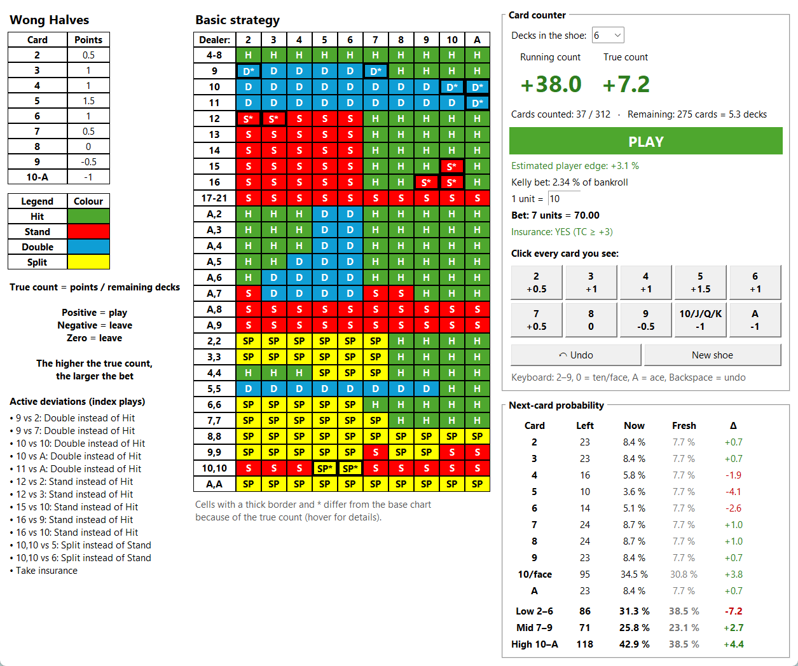

# Blackjack Counter

[](https://github.com/Tristan-sketch/blackjack-counter/actions/workflows/tests.yml)


[](LICENSE)

A desktop app that turns my blackjack spreadsheet into a live tool: the basic-strategy chart,
a Wong Halves card counter, and a chart that changes with the true count. You click every card
you see, and the app keeps the running count, the true count, the odds for the next card and a
suggested bet up to date.

The interface is in German, because the spreadsheet it is built from is German.



## Features

| Part | What it does |
|---|---|
| Strategy chart | Hard totals, soft hands and pairs against every dealer upcard, coloured like the original spreadsheet (Hit, Stay, Double, Split) |
| Card counter | One button per card (2–9, 10/face, ace) with its Wong Halves value, plus keyboard shortcuts, undo and a new-shoe button; 1–8 decks |
| True count | Running count divided by the remaining decks, which the app works out from the cards already counted |
| Index plays | The "Illustrious 18" deviations: cells whose best play changes at the current true count get a thick border and a `*`, and hovering a cell shows its index |
| Next-card odds | Cards left per rank and the chance that the next card is a 2, 3, …, 10 or ace, compared with a fresh shoe |
| Edge and bet | Estimated player edge, a bet in units (and euros), an enter/leave signal and an insurance hint |

## How it works

**Wong Halves.** Every card adds a fixed value to the running count:

| Card | 2 | 3 | 4 | 5 | 6 | 7 | 8 | 9 | 10–A |
|---|---|---|---|---|---|---|---|---|---|
| Points | +0.5 | +1 | +1 | +1.5 | +1 | +0.5 | 0 | −0.5 | −1 |

**True count** = running count / remaining decks. A positive true count means the shoe is rich in
tens and aces, which favours the player: the app says "Einsteigen" (enter) and raises the bet. At
zero or below it says "Aussteigen" (leave).

**Index plays.** The basic-strategy chart assumes a neutral shoe. Seventeen hands, plus insurance (together the "Illustrious 18"),
are played differently once the true count passes a threshold, for example standing on 16 against a
10 from a true count of 0, or taking insurance from +3.

**Rules of thumb.** Edge ≈ −0.5 % + 0.5 % per true-count point. Bet = true count rounded down,
between 1 and 8 units, and nothing at a true count of 0 or below.

## Notes on the chart

The chart follows my original spreadsheet, with four cells changed to standard multi-deck basic
strategy: always split aces, always split eights, double 11 against a 10, and double soft 13 (A,2)
against a 5.

The index thresholds are the published Hi-Lo values. Wong Halves runs on a very similar scale, so
they are a close approximation rather than exact Halves indices. The edge and bet formulas are
approximations too.

## Run it

Needs Python 3.10 or newer; the app uses only the standard library.

```bash
python blackjack_counter.py
```

On Windows you can double-click `Blackjack_starten.bat`. It uses [uv](https://docs.astral.sh/uv/)
to set up the environment and starts the app without a console window.

Keyboard: `2`–`9` for those cards, `0` or `T` for a ten or face card, `A` for an ace, Backspace to undo.

## Tests

```bash
uv run pytest
```

The tests cover the counting values, the strategy chart (including spot checks against the
spreadsheet), the index plays, the shoe bookkeeping, the probabilities and the bet rules. GitHub
Actions runs them on every push.

## Project layout

```
blackjack_counter.py   app: data, counting logic and tkinter interface
tests/                 pytest suite for the logic
Blackjack_starten.bat  Windows launcher
docs/screenshot.png    screenshot for this README
```

## Disclaimer

This is a study and practice tool. Card counting is legal in most places, but casinos may refuse
to deal to counters, and using any device at the table is usually against the rules. No strategy
removes the risk of losing money.

## License

[MIT](LICENSE)
